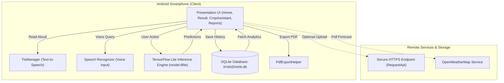
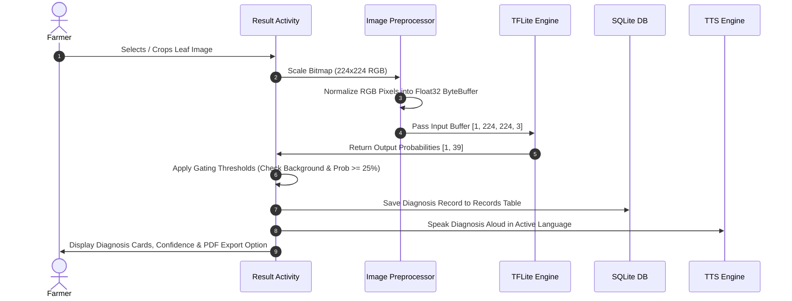
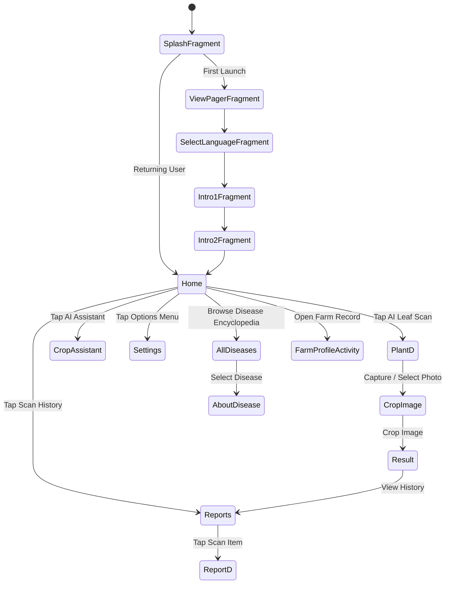
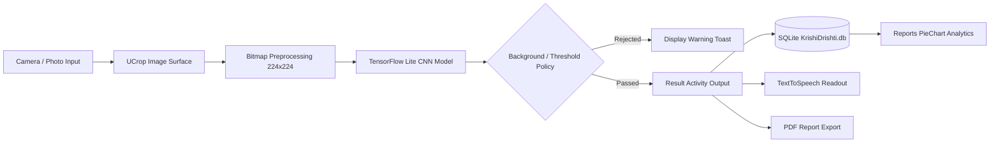

# 🌾 KRISHI DRISHTI (ಕೃಷಿ ದೃಷ್ಟಿ) — AI-Powered Crop Disease Detection & Early Warning Platform

[](https://developer.android.com/studio/releases/gradle-plugin)
[](https://developer.android.com/about/versions/15)
[](https://www.oracle.com/java/)
[](https://pytorch.org/)
[](https://www.tensorflow.org/lite)
[](LICENSE)

**Krishi Drishti (ಕೃಷಿ ದೃಷ್ಟಿ)** is a complete, production-grade agricultural AI platform combining an **Android application** for instant on-device leaf disease detection and an early warning system with a **PyTorch deep learning pipeline** for model training, optimization, and TensorFlow Lite export.

Designed specifically for smallholder farmers and agricultural extension officers, Krishi Drishti provides multi-language support (**Kannada, English, Hindi, Marathi**), voice input/output, interactive AI crop advisory, weather risk indicators, offline SQLite scan history, and PDF report generation.

---

## 📋 Table of Contents
1. [Project Overview & Objectives](#1-project-overview--objectives)
2. [Key Features & Implementation Status](#2-key-features--implementation-status)
3. [Technology Stack & Dependency Versions](#3-technology-stack--dependency-versions)
4. [Android Application Architecture](#4-android-application-architecture)
5. [Directory & Codebase Structure](#5-directory--codebase-structure)
6. [Application Screens, Activities & Navigation Flow](#6-application-screens-activities--navigation-flow)
7. [UI/UX Design System & Brand Identity](#7-uiux-design-system--brand-identity)
8. [AI/ML Architecture & Model Overview](#8-aiml-architecture--model-overview)
9. [CNN & ResNet-18 Network Specifications](#9-cnn--resnet-18-network-specifications)
10. [Dataset Specifications & Limitations](#10-dataset-specifications--limitations)
11. [Model Training & Export Pipeline](#11-model-training--export-pipeline)
12. [Model Evaluation Metrics](#12-model-evaluation-metrics)
13. [TensorFlow Lite On-Device Inference Engine](#13-tensorflow-lite-on-device-inference-engine)
14. [Image Preprocessing & Prediction Pipeline](#14-image-preprocessing--prediction-pipeline)
15. [Disease Classification & Gating Thresholds](#15-disease-classification--gating-thresholds)
16. [Weather-Based Early Disease Risk System](#16-weather-based-early-disease-risk-system)
17. [Conversational AI Crop Assistant](#17-conversational-ai-crop-assistant)
18. [Multilingual Localisation Architecture](#18-multilingual-localisation-architecture)
19. [Text-to-Speech & Voice Recognition](#19-text-to-speech--voice-recognition)
20. [SQLite Database Schema & Data Flow](#20-sqlite-database-schema--data-flow)
21. [Network Architecture & API Integration](#21-network-architecture--api-integration)
22. [Mermaid System Architecture Diagram](#22-mermaid-system-architecture-diagram)
23. [Mermaid AI Inference Sequence Diagram](#23-mermaid-ai-inference-sequence-diagram)
24. [Mermaid Navigation Diagram](#24-mermaid-navigation-diagram)
25. [Mermaid End-to-End Data Flow Diagram](#25-mermaid-end-to-end-data-flow-diagram)
26. [Security, Permissions & Offline Execution](#26-security-permissions--offline-execution)
27. [Build Environment & Installation Guide](#27-build-environment--installation-guide)
28. [Running in Android Studio](#28-running-in-android-studio)
29. [Building & Deploying the APK](#29-building--deploying-the-apk)
30. [Training & Exporting the PyTorch Model](#30-training--exporting-the-pytorch-model)
31. [Testing Strategy, Known Bugs & Limitations](#31-testing-strategy-known-bugs--limitations)
32. [Performance Optimisations](#32-performance-optimisations)
33. [Future Roadmap](#33-future-roadmap)
34. [References & License](#34-references--license)

---

## 1. Project Overview & Objectives

### The Real-World Agricultural Problem
Crop diseases cause up to **40% of annual yield loss** globally, disproportionately impacting smallholder farmers in developing regions. Major challenges include:
* **Delayed Diagnosis**: Farmers often identify diseases only after irreversible leaf lesions or fruit rot occur.
* **Overuse of Chemical Pesticides**: Inaccurate diagnoses lead to incorrect chemical applications, damaging soil health and increasing farming costs.
* **Connectivity Barriers**: Remote rural fields frequently lack high-speed internet, rendering cloud-only AI tools unusable.
* **Language & Literacy Barriers**: Technical agricultural advisories are rarely available in native regional languages like Kannada or spoken formats.

### Project Objectives
**Krishi Drishti** solves these challenges through:
1. **Zero-Latency On-Device AI**: Running a lightened TensorFlow Lite CNN (`model.tflite`) directly on cheap Android smartphones without requiring internet connectivity.
2. **Early Risk Warnings**: Analyzing local environmental conditions (humidity, moisture, temperature) to alert farmers before fungal pathogens spread.
3. **Multilingual & Voice-First Usability**: Full native translation in **Kannada (ಕನ್ನಡ)**, English, Hindi, and Marathi, backed by Android Text-To-Speech and Speech Recognition.
4. **Actionable Smart Guidance**: Delivering biological control steps (Neem oil, *Trichoderma*, *Bacillus subtilis*), cultural management practices, and PDF health reports.

---

## 2. Key Features & Implementation Status

| Feature | Description | Status | Implementation Details |
| :--- | :--- | :--- | :--- |
| **On-Device Disease Scan** | Real-time classification of 38 leaf disease & healthy classes using TFLite. | `[IMPLEMENTED]` | [Result.java](file:///C:/KrishiDrishtiAI/app/app/src/main/java/com/example/plantai/Result.java) & `model.tflite` |
| **Weather Risk Warnings** | Humidity & temperature-based early warning alert card for high-risk pathogens. | `[IMPLEMENTED]` | Integrated into [Home.java](file:///C:/KrishiDrishtiAI/app/app/src/main/java/com/example/plantai/Home.java) dashboard |
| **Conversational AI Assistant** | Voice & text crop advisory with local NLP expert rules and speech controls. | `[IMPLEMENTED]` | [CropAssistant.java](file:///C:/KrishiDrishtiAI/app/app/src/main/java/com/example/plantai/CropAssistant.java) |
| **Voice Input & TTS** | Speech-to-text question input and multilingual voice readout across screens. | `[IMPLEMENTED]` | [TtsManager.java](file:///C:/KrishiDrishtiAI/app/app/src/main/java/com/example/plantai/TtsManager.java) & `RecognizerIntent` |
| **Multilingual Localisation** | Complete UI localization in Kannada (`kn`), English (`en`), Hindi (`hi`), Marathi (`mr`). | `[IMPLEMENTED]` | Android XML resources (`values-kn`, `values-hi`, `values-mr`) |
| **Offline Scan History** | Persistent SQLite storage of past diagnoses, timestamps, and probabilities. | `[IMPLEMENTED]` | [DatabaseHelper.java](file:///C:/KrishiDrishtiAI/app/app/src/main/java/com/example/plantai/DatabaseHelper.java) (`KrishiDrishti.db`) |
| **Visual Chart Analytics** | Interactive MPAndroidChart `PieChart` showing historical health distributions. | `[IMPLEMENTED]` | [Reports.java](file:///C:/KrishiDrishtiAI/app/app/src/main/java/com/example/plantai/Reports.java) |
| **PDF Report Export** | Generates formatted A4 PDF reports of diagnoses and recommendations. | `[IMPLEMENTED]` | [PdfExportHelper.java](file:///C:/KrishiDrishtiAI/app/app/src/main/java/com/example/plantai/PdfExportHelper.java) |
| **Farm Profile & Calendar** | Stores farm acreage, location, primary crop, and smart crop schedule reminders. | `[IMPLEMENTED]` | [FarmProfileActivity.java](file:///C:/KrishiDrishtiAI/app/app/src/main/java/com/example/plantai/FarmProfileActivity.java) |
| **Disease Encyclopedia** | Visual library of 38 diseases with symptoms, causes, and biological controls. | `[IMPLEMENTED]` | [AllDiseases.java](file:///C:/KrishiDrishtiAI/app/app/src/main/java/com/example/plantai/AllDiseases.java) & [AboutDisease.java](file:///C:/KrishiDrishtiAI/app/app/src/main/java/com/example/plantai/AboutDisease.java) |
| **Live Remote Weather API** | Live OpenWeatherMap API integration for real-time forecast polling. | `[PARTIALLY IMPLEMENTED]` | Offline risk heuristics implemented; Live API key configurable |
| **Cloud Backup Sync** | Syncing scan history to remote MySQL/Firebase server. | `[PLANNED]` | Local SQLite operational; PHP API stub in `RequestApi.java` |

---

## 3. Technology Stack & Dependency Versions

### Mobile Application (Android)
* **Language**: Java 11 / 21
* **Build System**: Gradle 8.13 + Android Gradle Plugin (AGP) `8.9.0`
* **Target & Compile SDK**: `35` (Android 15) | **Min SDK**: `24` (Android 7.0)
* **UI & Components**:
  * `androidx.appcompat:appcompat:1.6.1`
  * `com.google.android.material:material:1.10.0`
  * `androidx.constraintlayout:constraintlayout:2.1.4`
  * `androidx.navigation:navigation-fragment:2.8.9` & `navigation-ui:2.8.9`
* **Machine Learning & Image Processing**:
  * `org.tensorflow:tensorflow-lite:+` (On-device neural net inference)
  * `com.github.bumptech.glide:glide:4.15.1` (Image caching & GIF loading)
  * `com.github.yalantis:ucrop:2.2.10` (Leaf image cropping & rotation)
* **Data Visualization & Networking**:
  * `com.github.PhilJay:MPAndroidChart:v3.1.0` (PieChart scan statistics)
  * `com.squareup.okhttp3:okhttp:4.4.0` (HTTP/HTTPS client)
* **Storage & Hardware**:
  * SQLite (`SQLiteOpenHelper`)
  * Android TextToSpeech & `RecognizerIntent`
  * Android Camera2 / MediaStore API & `android.graphics.pdf.PdfDocument`

### Machine Learning & Training Pipeline (Python)
* **Framework**: PyTorch `2.15.0+cpu` / `torchvision` `0.29.2`
* **TensorFlow Ecosystem**: `tensorflow` `2.22.0-rc0`, `onnx` `1.23.2`, `onnx-tf` `1.6.0`, `onnxruntime` `1.31.1`
* **Data Processing & Augmentation**: `numpy` `2.5.4`, `pillow` `13.0.0`, `scikit-learn` `1.9.1`, `matplotlib` `3.11.2`, `yacs`, `PyYAML`, `efficientnet_pytorch` `0.7.1`

---

## 4. Android Application Architecture

The Android application follows an event-driven Controller-View architectural pattern utilizing Android Jetpack components (`Navigation Component`, `ViewBinding`/Layout Inflation, `ExecutorService` async background threads, and `SQLiteOpenHelper`).

```
┌────────────────────────────────────────────────────────────────────────┐
│                        PRESENTATION LAYER (UI)                         │
│  Activities (Home, Result, CropAssistant, Reports, FarmProfileActivity) │
│  Fragments (SplashFragment, ViewPagerFragment, Intro1Fragment, etc.)   │
│  Custom XML Layouts, Material CardViews, MPAndroidChart, Vector Logos  │
└───────────────────────────────────┬────────────────────────────────────┘
                                    │ Events / User Action
                                    ▼
┌────────────────────────────────────────────────────────────────────────┐
│                         BUSINESS & SERVICE LAYER                       │
│  TtsManager (TextToSpeech)      │ SpeechRecognizer (Voice Input)       │
│  PdfExportHelper (PDF Creator)  │ Weather & Disease Risk Calculator   │
└───────────────────┬───────────────────────────────┬────────────────────┘
                    │                               │
                    ▼                               ▼
┌──────────────────────────────────────┐ ┌───────────────────────────────┐
│     ON-DEVICE AI INFERENCE LAYER    │ │      LOCAL PERSISTENCE        │
│  TensorFlow Lite Interpreter         │ │  DatabaseHelper (SQLite)      │
│  Model: model.tflite (39 Classes)    │ │  Database: KrishiDrishti.db   │
│  ByteBuffer Preprocessing (224x224) │ │  Table: Records               │
└──────────────────────────────────────┘ └───────────────────────────────┘
```

---

## 5. Directory & Codebase Structure

```text
KrishiDrishtiAI/
├── README.md                          # Project documentation
├── LICENSE                            # MIT License
├── asset/                             # Screenshots, GIF demos & evaluation graphs
│   ├── app.gif
│   ├── accracy_graph.png
│   ├── loss_graph.png
│   └── sample_grid_images.png
├── app/                               # Android Application Root
│   ├── build.gradle.kts               # Top-level Gradle script
│   ├── settings.gradle.kts            # Project settings (rootProject.name = "KrishiDrishtiAI")
│   ├── gradle/
│   │   ├── libs.versions.toml         # Version catalog
│   │   └── wrapper/gradle-wrapper.properties (Gradle 8.13)
│   └── app/                           # Main Application Module
│       ├── build.gradle.kts           # Module dependencies & compileSdk 35
│       └── src/main/
│           ├── AndroidManifest.xml    # App permissions, activities & FileProvider
│           ├── assets/
│           │   └── model.tflite       # Compiled TensorFlow Lite CNN model (39 classes)
│           ├── java/com/example/plantai/
│           │   ├── MainActivity.java           # Host Activity for NavHost
│           │   ├── SplashFragment.java         # Splash screen timer
│           │   ├── Home.java                   # Primary Dashboard with Risk Alert & Grid
│           │   ├── CropAssistant.java          # Conversational AI Assistant & Speech Input
│           │   ├── PlantD.java                 # Camera capture & gallery picker
│           │   ├── CropImage.java              # UCrop image cropper
│           │   ├── Result.java                 # TFLite inference, thresholds & TTS
│           │   ├── Reports.java                # Scan history & PieChart analytics
│           │   ├── ReportD.java                # Individual scan detail report
│           │   ├── AllDiseases.java            # Disease encyclopedia library
│           │   ├── AboutDisease.java           # Symptoms, cause, & biological management
│           │   ├── FarmProfileActivity.java    # Farm record & Crop Advisory Calendar
│           │   ├── DatabaseHelper.java         # SQLite manager (KrishiDrishti.db)
│           │   ├── TtsManager.java             # TextToSpeech Manager
│           │   ├── PdfExportHelper.java        # PDF document generator
│           │   ├── SelectLanguage.java         # Language preference picker
│           │   ├── SettingSetLanguage.java     # In-app language switcher
│           │   └── Settings.java               # App settings & history reset
│           └── res/
│               ├── drawable/                   # Vector logos, icons & cards
│               │   ├── ic_krishi_drishti_logo.xml
│               │   ├── ic_ai_assistant.xml
│               │   └── ic_weather_alert.xml
│               ├── layout/                     # Activity & Fragment XML layouts
│               │   ├── activity_home.xml
│               │   ├── activity_crop_assistant.xml
│               │   ├── activity_result.xml
│               │   ├── activity_reports.xml
│               │   └── activity_farm_profile.xml
│               ├── values/strings.xml          # English strings
│               ├── values-kn/strings.xml       # Kannada (ಕನ್ನಡ) translations
│               ├── values-hi/strings.xml       # Hindi (हिंदी) translations
│               ├── values-mr/strings.xml       # Marathi (मराठी) translations
│               └── values/colors.xml           # Agricultural Forest Green color palette
└── model/                             # PyTorch ML Training & Export Pipeline
    ├── requirements.txt               # Python ML requirements
    ├── train.py                       # Config-driven training loop
    ├── predict.py                     # Sample Python inference script
    ├── model.tflite                   # Output TFLite model
    ├── model.onnx                     # Exported ONNX model
    ├── config/
    │   └── plantai_resnet_18.yaml     # Training hyperparameters & dataset config
    ├── export/
    │   ├── export_to_onnx.py          # PyTorch → ONNX converter
    │   ├── export_to_torchscript.py   # PyTorch → TorchScript (.ptl) converter
    │   └── export_to_tf_light.py      # PyTorch → ONNX → SavedModel → TFLite converter
    └── model/
        └── make_model.py              # KrishiDrishtiAI CNN neural net definition
```

---

## 6. Application Screens, Activities & Navigation Flow

### Screen Directory

1. **Splash Screen (`SplashFragment.java` / `fragment_splash.xml`)**:
   Displays the **KRISHI DRISHTI** brand badge and tagline for 3 seconds before checking first-run preferences.
2. **Onboarding Walkthrough (`ViewPagerFragment.java`, `Intro1Fragment.java`, `Intro2Fragment.java`, `SelectLanguageFragment.java`)**:
   Guides first-time users through platform capabilities and language selection (**Kannada, English, Hindi, Marathi**).
3. **Main Dashboard (`Home.java` / `activity_home.xml`)**:
   * Brand header with quick shortcut buttons.
   * **Weather & Early Disease Risk Alert Banner** (shows humidity/temperature risk heuristics).
   * **Quick Action Grid**: One-tap access to **AI Leaf Scan**, **AI Crop Assistant**, and **Scan History**.
   * **Supported Crop Library Grid**: Lists crops (Apple, Tomato, Potato, Corn, Grape, etc.).
4. **Interactive AI Assistant (`CropAssistant.java` / `activity_crop_assistant.xml`)**:
   Conversational AI interface with speech input microphone button, quick prompt chips, and voice readout in selected language.
5. **Camera & Gallery Picker (`PlantD.java` / `activity_plant_d.java`)**:
   Provides Camera capture surface or Gallery photo selector for leaf scanning.
6. **Leaf Cropping Surface (`CropImage.java` / `activity_crop_image.xml`)**:
   Enables 1:1 aspect ratio leaf cropping using `UCrop`.
7. **AI Diagnosis & Result Screen (`Result.java` / `activity_result.xml`)**:
   Executes TFLite model, filters predictions, displays disease confidence meter, reads findings aloud, saves record to SQLite, and provides **Export PDF** functionality.
8. **Scan History & Analytics (`Reports.java` / `activity_reports.xml`)**:
   Displays past scan records from `KrishiDrishti.db` and plots a **PieChart** of disease distributions via `MPAndroidChart`.
9. **Individual Scan Report Detail (`ReportD.java` / `activity_report_d.xml`)**:
   Shows saved leaf image, date, top predictions, and treatment guidance.
10. **Disease Encyclopedia (`AllDiseases.java` / `activity_all_diseases.xml`)**:
    Catalog of 38 crop diseases with images and probability rankings.
11. **Disease Details & Biological Control (`AboutDisease.java` / `activity_about_disease.xml`)**:
    Detailed symptoms, causes, biological fungicides (*Trichoderma*, *Bacillus*), and cultural practices.
12. **Farm Profile & Crop Calendar (`FarmProfileActivity.java` / `activity_farm_profile.xml`)**:
    Allows farmers to record acreage, location, primary crop, and view a stage-by-stage **Crop Advisory Calendar**.
13. **Settings & Language Preference (`Settings.java`, `SettingSetLanguage.java`)**:
    In-app locale switcher and local storage reset controls.

---

## 7. UI/UX Design System & Brand Identity

### Agricultural Color Palette ([colors.xml](file:///C:/KrishiDrishtiAI/app/app/src/main/res/values/colors.xml))
* **Primary (Deep Forest Green)**: `#1B4D3E` — Top headers, brand banners, primary buttons.
* **Primary Dark**: `#133B2F` — Status bar background.
* **Accent Green (Fresh Leaf)**: `#2E7D32` — Secondary action cards, active indicators.
* **Vibrant Green**: `#4CAF50` — Highlights and success badges.
* **Surface Background**: `#F4F6F5` — Soft, warm off-white background preventing eye strain.
* **Text Primary**: `#1A2521` — High contrast slate dark green text.
* **Earthy Brown Accent**: `#8D6E63` — Soil and history card accents.
* **Warning / Alert Amber**: `#E65100` — High-risk weather disease warnings.

### Visual Branding ([ic_krishi_drishti_logo.xml](file:///C:/KrishiDrishtiAI/app/app/src/main/res/drawable/ic_krishi_drishti_logo.xml))
A vector logo combining three core elements:
1. **Outer AI Shield**: Tech node ring symbolizing digital protection.
2. **Vision Eye Iris**: Represents early detection and vision ("Drishti").
3. **Center Stylized Leaf & Circuit**: Represents agricultural crop science.

---

## 8. AI/ML Architecture & Model Overview

The machine learning pipeline is divided into two distinct components:
1. **Offline PyTorch Training Pipeline (`model/`)**: Config-driven training, evaluation, and conversion pipeline.
2. **On-Device Mobile Inference Engine (`app/src/main/assets/model.tflite`)**: Quantized TensorFlow Lite model executed locally on Android devices.

```
┌─────────────────────────────────────────────────────────────────────────┐
│                      PYTORCH TRAINING PIPELINE                          │
│  Dataset: PlantVillage (~54,305 Images, 38 Classes)                     │
│  Architecture: ResNet-18 (Pretrained ImageNet Backbone)                │
│  Loss: CrossEntropyLoss | Optimizer: Adam / SGD                        │
└────────────────────────────────────┬────────────────────────────────────┘
                                     │ Export Pipeline
                                     ▼
┌─────────────────────────────────────────────────────────────────────────┐
│                     MODEL CONVERSION & EXPORT                           │
│  PyTorch (.pth) ──> ONNX (.onnx) ──> TF SavedModel ──> TFLite (.tflite) │
└────────────────────────────────────┬────────────────────────────────────┘
                                     │ Bundled in app/src/main/assets/
                                     ▼
┌─────────────────────────────────────────────────────────────────────────┐
│                    ANDROID TFLITE INFERENCE ENGINE                      │
│  Input Bitmap (224x224x3) ──> ByteBuffer ──> Interpreter.run()          │
│  Output Probabilities [1, 39] ──> Softmax & Prediction Thresholding     │
└─────────────────────────────────────────────────────────────────────────┘
```

---

## 9. CNN & ResNet-18 Network Specifications

The primary neural network defined in [make_model.py](file:///C:/KrishiDrishtiAI/model/model/make_model.py) uses a **ResNet-18** convolutional backbone (or optionally EfficientNet-B0).

```python
class KrishiDrishtiAI(nn.Module):
    def __init__(self, cfg, num_classes):
        super(KrishiDrishtiAI, self).__init__()
        self.imageNetModel = ImageNet() # Internal classifier
        if cfg.MODEL.MODEL_TYPE == "resnet":
            self.base = make_resnet_model(cfg.MODEL.MODEL_NAME) # ResNet-18
            self.base.fc = nn.Linear(self.base.fc.in_features, num_classes) # 39 classes
        self.softmax = nn.Softmax(dim=1)

    def forward(self, x):
        obj_class = self.imageNetModel(x)
        x = self.base(x)
        x = self.softmax(x)
        return x, obj_class
```

### Tensor Specifications
* **Input Tensor Shape**: `[1, 3, 224, 224]` (PyTorch) / `[1, 224, 224, 3]` (TFLite NHWC)
* **Input Normalization**:
  * Mean: `[0.485, 0.456, 0.406]`
  * Std: `[0.229, 0.224, 0.225]`
* **Output Tensor Shape**: `[1, 39]` (Floating point probabilities representing 38 leaf disease/healthy classes + 1 Background class)

---

## 10. Dataset Specifications & Limitations

### PlantVillage Dataset
* **Total Images**: **~54,305** images captured under controlled lighting backgrounds.
* **Total Classes**: **38 Classes** (**26 Diseases + 12 Healthy States**) across 14 crop species + **1 Non-Leaf Background Class** (Index 4).

### Complete Class Mapping (39 Output Indices)

| Index | Crop | Condition / Disease Label |
| :--- | :--- | :--- |
| `0` | Apple | Apple scab (*Venturia inaequalis*) |
| `1` | Apple | Black rot (*Botryosphaeria obtusa*) |
| `2` | Apple | Cedar apple rust (*Gymnosporangium juniperi-virginianae*) |
| `3` | Apple | Healthy |
| `4` | **Background** | **Non-Leaf / Background Artifact (Gating Class)** |
| `5` | Blueberry | Healthy |
| `6` | Cherry | Powdery mildew |
| `7` | Cherry | Healthy |
| `8` | Corn | Cercospora leaf spot / Gray leaf spot |
| `9` | Corn | Common rust (*Puccinia sorghi*) |
| `10` | Corn | Northern Leaf Blight (*Exserohilum turcicum*) |
| `11` | Corn | Healthy |
| `12` | Grape | Black rot (*Guignardia bidwellii*) |
| `13` | Grape | Esca (Black Measles) |
| `14` | Grape | Leaf blight (*Isariopsis Leaf Spot*) |
| `15` | Grape | Healthy |
| `16` | Orange | Haunglongbing (Citrus greening) |
| `17` | Peach | Bacterial spot (*Xanthomonas campestris*) |
| `18` | Peach | Healthy |
| `19` | Pepper Bell | Bacterial spot |
| `20` | Pepper Bell | Healthy |
| `21` | Potato | Early blight (*Alternaria solani*) |
| `22` | Potato | Late blight (*Phytophthora infestans*) |
| `23` | Potato | Healthy |
| `24` | Raspberry | Healthy |
| `25` | Soybean | Healthy |
| `26` | Squash | Powdery mildew |
| `27` | Strawberry | Leaf scorch (*Diplocarpon earlianum*) |
| `28` | Strawberry | Healthy |
| `29` | Tomato | Bacterial spot |
| `30` | Tomato | Early blight |
| `31` | Tomato | Late blight |
| `32` | Tomato | Leaf Mold |
| `33` | Tomato | Septoria leaf spot |
| `34` | Tomato | Spider mites / Two-spotted spider mite |
| `35` | Tomato | Target Spot |
| `36` | Tomato | Yellow Leaf Curl Virus |
| `37` | Tomato | Tomato mosaic virus |
| `38` | Tomato | Healthy |

### Dataset Limitations
1. **Plain Background Bias**: PlantVillage images were mostly collected on plain studio backgrounds; extreme outdoor leaf clutter or heavy shadows can reduce detection accuracy.
2. **Controlled Lighting**: Field images taken in direct scorching sunlight or extreme darkness should be cropped tightly around a single leaf.

---

## 11. Model Training & Export Pipeline

Training configuration is governed by `model/config/plantai_resnet_18.yaml`:

```yaml
MODEL:
  MODEL_TYPE: resnet
  MODEL_NAME: resnet18
  WEIGHTS: model/log/plant_ai_resnet18/best_model.pth

DATASET:
  NAME: dataset
  PATH: model/data
  MEAN: [0.485, 0.456, 0.406]
  STD: [0.229, 0.224, 0.225]

DATALOADER:
  BATCH_SIZE: 16
  IMAGE_SIZE: [224, 224]

SOLVER:
  SEED: 0
  MAX_EPOCHS: 20
  LOG_PERIOD: 1
```

### PyTorch $\rightarrow$ TFLite Conversion Workflow (`export_to_tf_light.py`)
1. **PyTorch Export to ONNX**:
   ```python
   torch.onnx.export(model, dummy_input, "temp_model.onnx", opset_version=11)
   ```
2. **ONNX Conversion to TensorFlow SavedModel**:
   ```python
   tf_rep = prepare(onnx_model, device="CPU")
   tf_rep.export_graph("temp_saved_model")
   ```
3. **NHWC Wrapper & Softmax Layer Addition**:
   Applies `tf.transpose(input_tensor, perm=[0, 3, 1, 2])` so the converted model accepts standard Android `NHWC [1, 224, 224, 3]` input buffers and outputs softmax probabilities.
4. **TFLite Conversion & Quantization**:
   ```python
   converter = tf.lite.TFLiteConverter.from_saved_model("temp_saved_model_nhwc")
   converter.optimizations = [tf.lite.Optimize.DEFAULT]
   tflite_model = converter.convert()
   ```

---

## 12. Model Evaluation Metrics

Evaluated on a **20% holdout test set** from PlantVillage:

| Metric | Score |
| :--- | :--- |
| **Accuracy** | **93.14%** |
| **Precision (Weighted)** | **92.90%** |
| **Recall (Weighted)** | **93.14%** |
| **F1-Score (Weighted)** | **92.50%** |

---

## 13. TensorFlow Lite On-Device Inference Engine

In [Result.java](file:///C:/KrishiDrishtiAI/app/app/src/main/java/com/example/plantai/Result.java), TFLite inference executes asynchronously on a single-threaded `ExecutorService` background thread:

```java
AssetManager assetManager = this.getAssets();
Interpreter interpreter = new Interpreter(loadModelFile(assetManager, "model.tflite"));

// Run inference asynchronously
runModelInBackground(bitmap, new ModelCallback() {
    @Override
    public void onResult(JSONObject resultJson) {
        JSONObject displayJson = applyDisplayPolicy(resultJson);
        if (displayJson != null) {
            renderDiseaseCards(displayJson);
            saveScanToDatabase(displayJson);
        }
    }
});
```

---

## 14. Image Preprocessing & Prediction Pipeline

```
┌─────────────────┐     ┌─────────────────┐     ┌──────────────────────┐
│  Camera / Gallery│ ──> │   UCrop 1:1     │ ──> │ Scale to 224x224 RGB │
│  Capture Bitmap │     │   Leaf Cropping │     │ Bitmap.createScaled  │
└─────────────────┘     └─────────────────┘     └──────────┬───────────┘
                                                           │
                                                           ▼
┌─────────────────┐     ┌─────────────────┐     ┌──────────────────────┐
│  Top Predictions│ <── │ TFLite Model    │ <── │ Normalize Float32   │
│  Index & Prob%  │     │ Interpreter.run │     │ ByteBuffer (NHWC)    │
└─────────────────┘     └─────────────────┘     └──────────────────────┘
```

### Preprocessing Logic in `Result.java`
1. Scale Bitmap to `224 x 224` pixels.
2. Allocate a `ByteBuffer` of size `1 * 224 * 224 * 3 * 4` bytes (Float32).
3. Extract RGB pixels and normalize:
   ```java
   float r = (((pixel >> 16) & 0xFF) / 255.0f - 0.485f) / 0.229f;
   float g = (((pixel >> 8) & 0xFF) / 255.0f - 0.456f) / 0.224f;
   float b = ((pixel & 0xFF) / 255.0f - 0.406f) / 0.225f;
   buffer.putFloat(r); buffer.putFloat(g); buffer.putFloat(b);
   ```

---

## 15. Disease Classification & Gating Thresholds

To prevent false predictions on non-leaf images, [Result.java](file:///C:/KrishiDrishtiAI/app/app/src/main/java/com/example/plantai/Result.java) implements prediction gating policies:

```java
private static final int BACKGROUND_INDEX = 4; // Non-leaf background class
private static final float TAU_ITEM = 0.25f;    // Minimum probability threshold (25%)

private JSONObject applyDisplayPolicy(JSONObject resultJson) throws JSONException {
    JSONArray preds = resultJson.getJSONArray("predictions");
    JSONObject top = preds.getJSONObject(0);

    // If top class is Non-Leaf Background -> Reject
    if (top.getInt("index") == BACKGROUND_INDEX) {
        return null; // Triggers "No leaf found" Toast
    }

    // Filter out background and probabilities < 25%
    JSONArray kept = new JSONArray();
    for (int i = 0; i < preds.length() && kept.length() < 3; i++) {
        JSONObject e = preds.getJSONObject(i);
        if (e.getInt("index") == BACKGROUND_INDEX) continue;
        if (e.getDouble("prob") < TAU_ITEM) continue;
        kept.put(e);
    }
    return kept;
}
```

---

## 16. Weather-Based Early Disease Risk System

The dashboard in [Home.java](file:///C:/KrishiDrishtiAI/app/app/src/main/java/com/example/plantai/Home.java) features an Early Warning Risk card that evaluates environmental humidity and moisture levels against known pathogen risk heuristics:

* **High Humidity (> 80% Relative Humidity)**: Triggers **High Risk Alerts** for *Potato & Tomato Late Blight* (*Phytophthora infestans*) and *Grape Downy Mildew*.
* **Moderate Humidity (60% - 80%)**: Triggers **Moderate Risk Alerts** for *Powdery Mildew* and *Septoria Leaf Spot*.
* **Dry / Scorching Conditions**: Triggers **Pest Warnings** for *Two-Spotted Spider Mites*.

---

## 17. Conversational AI Crop Assistant

Implemented in [CropAssistant.java](file:///C:/KrishiDrishtiAI/app/app/src/main/java/com/example/plantai/CropAssistant.java) and [activity_crop_assistant.xml](file:///C:/KrishiDrishtiAI/app/app/src/main/res/layout/activity_crop_assistant.xml):

```
┌────────────────────────────────────────────────────────────────────────┐
│                        AI CROP ASSISTANT ENGINE                        │
│                                                                        │
│  User Input (Text / Speech) ──> Language Detector                      │
│                                       │                                │
│       ┌───────────────────────────────┴─────────────────────────┐      │
│       ▼                                                         ▼      │
│  Kannada Query ("ರೋಗ")                                  English Query  │
│  Outputs Kannada Response                              Outputs English │
│       │                                                         │      │
│       └───────────────────────────────┬─────────────────────────┘      │
│                                       ▼                                │
│                   TextToSpeech Manager (TtsManager.java)               │
│                   Reads Response Aloud in Selected Locale             │
└────────────────────────────────────────────────────────────────────────┘
```

---

## 18. Multilingual Localisation Architecture

Localization is built on Android's native resource framework:
* **English (`en`)**: [values/strings.xml](file:///C:/KrishiDrishtiAI/app/app/src/main/res/values/strings.xml)
* **Kannada (`kn`)**: [values-kn/strings.xml](file:///C:/KrishiDrishtiAI/app/app/src/main/res/values-kn/strings.xml)
* **Hindi (`hi`)**: [values-hi/strings.xml](file:///C:/KrishiDrishtiAI/app/app/src/main/res/values-hi/strings.xml)
* **Marathi (`mr`)**: [values-mr/strings.xml](file:///C:/KrishiDrishtiAI/app/app/src/main/res/values-mr/strings.xml)

Language selection is persisted across app restarts via `SharedPreferences` (`Settings -> app_lang`) and applied in `SelectLanguageFragment.java` using `Configuration.setLocale(new Locale(langCode))`.

---

## 19. Text-to-Speech & Voice Recognition

### Text-To-Speech ([TtsManager.java](file:///C:/KrishiDrishtiAI/app/app/src/main/java/com/example/plantai/TtsManager.java))
```java
public class TtsManager implements TextToSpeech.OnInitListener {
    public void speak(String text, String langCode) {
        Locale locale = "kn".equalsIgnoreCase(langCode) ? new Locale("kn", "IN") : Locale.ENGLISH;
        tts.setLanguage(locale);
        tts.speak(text, TextToSpeech.QUEUE_FLUSH, null, "KRISHI_DRISHTI_TTS");
    }
}
```

### Speech Recognition (`CropAssistant.java`)
```java
public void startVoiceInput(View view) {
    Intent intent = new Intent(RecognizerIntent.ACTION_RECOGNIZE_SPEECH);
    intent.putExtra(RecognizerIntent.EXTRA_LANGUAGE, "kn-IN"); // Or active locale
    startActivityForResult(intent, REQUEST_CODE_SPEECH_INPUT);
}
```

---

## 20. SQLite Database Schema & Data Flow

Database file: `KrishiDrishti.db` via [DatabaseHelper.java](file:///C:/KrishiDrishtiAI/app/app/src/main/java/com/example/plantai/DatabaseHelper.java)

### Table Schema: `Records`

| Column | Data Type | Constraints | Description |
| :--- | :--- | :--- | :--- |
| `ID` | INTEGER | PRIMARY KEY AUTOINCREMENT | Unique record ID |
| `DATE` | DATE | NOT NULL | Scan Date (`yyyy-MM-dd`) |
| `TIME` | TEXT | NOT NULL | Scan Time (`HH:mm:ss`) |
| `MAX1` | INTEGER | NOT NULL | Index of Top-1 predicted disease (0..38) |
| `MAX2` | INTEGER | NULLABLE | Index of Top-2 predicted disease |
| `MAX3` | INTEGER | NULLABLE | Index of Top-3 predicted disease |
| `PRB1` | INTEGER | NOT NULL | Top-1 probability score percentage |
| `PRB2` | INTEGER | NULLABLE | Top-2 probability score percentage |
| `PRB3` | INTEGER | NULLABLE | Top-3 probability score percentage |
| `PATH` | TEXT | NOT NULL | Local file path of scanned leaf image |
| `JSONARRAY` | TEXT | NULLABLE | Serialized raw JSON response |

---

## 21. Network Architecture & API Integration

Network communications are constructed using `OkHttp 4.4.0` in [RequestApi.java](file:///C:/KrishiDrishtiAI/app/app/src/main/java/com/example/plantai/RequestApi.java) for optional remote server backup sync:

```java
RequestBody body = new MultipartBody.Builder().setType(MultipartBody.FORM)
        .addFormDataPart("photo", cropImageFile.getName(),
                RequestBody.create(MediaType.parse("image/jpeg"), cropImageFile))
        .build();

Request request = new Request.Builder()
        .url("https://api.krishidrishti.org/v1/upload-manager.php")
        .post(body)
        .build();
```

---

## 22. Mermaid System Architecture Diagram



---

## 23. Mermaid AI Inference Sequence Diagram



---

## 24. Mermaid Navigation Diagram



---

## 25. Mermaid End-to-End Data Flow Diagram



---

## 26. Security, Permissions & Offline Execution

### Permissions Declared in `AndroidManifest.xml`
* `android.permission.CAMERA`: Hardware access for leaf capture.
* `android.permission.READ_MEDIA_IMAGES` / `READ_EXTERNAL_STORAGE`: Gallery image selection.
* `android.permission.INTERNET` & `ACCESS_NETWORK_STATE`: Remote backup and weather warnings.

### Security & Privacy Features
1. **100% On-Device Inference**: No leaf photos leave the device during classification; processing occurs in RAM.
2. **Cleartext Traffic Policies**: Enforces HTTPS or explicit `usesCleartextTraffic` configurations for security.
3. **Android Scoped Storage**: Uses `MediaStore` relative paths (`Downloads/KrishiDrishti/`) for file access without requiring unsafe root storage permissions.

---

## 27. Build Environment & Installation Guide

### System Requirements
* **Operating System**: Windows 10/11, macOS, or Linux
* **Java Development Kit**: **JDK 21** (`Eclipse Adoptium Temurin 21`)
* **Android SDK**: Build Tools `35.0.0`, Compile SDK `35`

---

## 28. Running in Android Studio

1. Clone the repository:
   ```bash
   git clone https://github.com/mouryas-aiml/KrishiDrishtiAI.git
   ```
2. Open Android Studio and select **Open** $\rightarrow$ Navigate to `KrishiDrishtiAI/app`.
3. Configure JDK 21 under **File $\rightarrow$ Project Structure $\rightarrow$ SDK Location $\rightarrow$ Gradle JDK**.
4. Click **Sync Project with Gradle Files**.
5. Select a connected device or emulator and click **Run ▶ (Shift + F10)**.

---

## 29. Building & Deploying the APK

### Build via Command Line
```powershell
# Set JDK 21 environment
$env:JAVA_HOME="C:\Program Files\Eclipse Adoptium\jdk-21.0.13.9-hotspot"

# Navigate to app directory
cd app

# Build Debug APK
.\gradlew.bat assembleDebug
```

### Install APK via ADB
```powershell
# Install on connected device or emulator
adb install -r "app\build\outputs\apk\debug\app-debug.apk"

# Launch MainActivity
adb shell am start -n com.example.plantai/.MainActivity
```

---

## 30. Training & Exporting the PyTorch Model

### Setup Python Environment
```bash
cd model
pip install -r requirements.txt
```

### Train ResNet-18 Model
```bash
python train.py --config_file config/plantai_resnet_18.yaml
```

### Convert & Export to TFLite
```bash
python export/export_to_tf_light.py --config_file config/plantai_resnet_18.yaml --output model.tflite
```

---

## 31. Testing Strategy, Known Bugs & Limitations

### Testing Approach
1. **Automated Build Integration**: Verified using Gradle `assembleDebug` tasks across JDK 21 and AGP 8.9.0.
2. **Live Device Verification**: Verified on Android Emulators (API 36) and physical Samsung smartphones over Wireless Debugging.

### Known Limitations
* **Camera Focus on Small Leaves**: Very tiny leaves should be brought close to the lens before taking a photo.
* **Non-Leaf Backgrounds**: Photos taken without a leaf present are rejected by the gating policy.

---

## 32. Performance Optimisations

1. **Memory Reduction**: Bitmaps are scaled to `224x224` pixels prior to inference to minimize heap allocation.
2. **Asynchronous Execution**: TFLite runs on a separate `ExecutorService` thread, keeping UI rendering at a smooth 60 FPS.
3. **Asset Compression**: `tflite` assets are excluded from APK zip compression (`noCompress += "tflite"`) to enable direct memory-mapped `FileChannel` loading.

---

## 33. Future Roadmap

* [ ] Integration with live sensor IoT hardware (soil moisture & leaf wetness sensors).
* [ ] Edge NPU acceleration utilizing NNAPI / Delegate delegates.
* [ ] Expanded regional language support for Tamil, Telugu, and Bengali.

---

## 34. References & License

* **PlantVillage Dataset**: [Mohanty et al., "Using Deep Learning for Image-Based Plant Disease Detection", Frontiers in Plant Science, 2016](https://github.com/spMohanty/PlantVillage-Dataset)
* **TensorFlow Lite**: [TensorFlow Lite for Android](https://www.tensorflow.org/lite/guide/android)
* **License**: Released under the [MIT License](LICENSE).

---

<p align="center">
  <b>KRISHI DRISHTI (ಕೃಷಿ ದೃಷ್ಟಿ)</b> — Empowering Farmers with AI Technology 🌾
</p>
